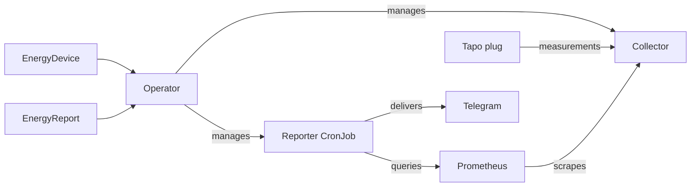

<div align="center">

# KubeWattch

### Kubernetes-native energy monitoring

<sub>Go · Kubebuilder · Prometheus</sub>

[](https://github.com/alvarorg14/kubewattch/actions/workflows/ci.yml)
[](https://github.com/alvarorg14/kubewattch/actions/workflows/security.yml)
[](LICENSE)

[Overview](#-overview) · [Quick Start](#-quick-start) · [Architecture](#-how-it-works) · [Contributing](CONTRIBUTING.md)

</div>

## 📋 Table of Contents

- [Overview](#-overview)
- [Why KubeWattch?](#-why-kubewattch)
- [Features and roadmap](#-features-and-roadmap)
- [Quick Start](#-quick-start)
- [Custom Resources](#-custom-resources)
- [Configuration](#️-configuration)
- [How It Works](#-how-it-works)
- [Documentation](#-documentation)
- [Local Development](#-local-development)
- [Contributing](#-contributing)
- [Security](#-security)
- [License](#-license)

## 📖 Overview

KubeWattch is an early-stage Kubernetes operator for monitoring electricity use and reporting estimated costs. It provisions collectors for Tapo P110-series plugs and schedules Prometheus-backed reports delivered to Telegram. Live Tapo hardware validation is pending.

## 🤔 Why KubeWattch?

KubeWattch brings device configuration, Prometheus monitoring, and scheduled consumption reports into a Kubernetes-native workflow. Namespaced resources describe the devices and reports, while the operator manages their workloads.

## ✨ Features and roadmap

- Namespaced `EnergyDevice` and `EnergyReport` APIs with generated CRDs.
- Tapo polling with authenticated HTTPS metrics for power and energy.
- Scheduled Telegram reports with estimated consumption, cost, and data coverage.
- Prometheus integration with optional ServiceMonitors and verified TLS.
- Additional device providers and report destinations are future work.

## 🚀 Quick Start

The Helm chart and images become available when [v0.2.0](https://github.com/alvarorg14/kubewattch/releases/tag/v0.2.0) is published. Scheduled reports require Kubernetes 1.32 or newer.

```sh
helm upgrade --install kubewattch oci://ghcr.io/alvarorg14/charts/kubewattch \
  --version 0.2.0 --namespace kubewattch-system --create-namespace --wait
```

Configure a device, connect Prometheus, and receive a Telegram report with the [getting started guide](docs/getting-started.md).

## 📡 Custom Resources

The namespaced API group is `energy.kubewattch.alvarorg14.github.io/v1alpha1`.

- **EnergyDevice** configures a Tapo device, polling interval, credentials, and collector metrics.
- **EnergyReport** selects devices in its namespace and configures a schedule, Prometheus endpoint, tariff, and Telegram destinations.

See the [custom resource API](docs/crds.md) for fields, defaults, validation, and status conditions.

## ⚙️ Configuration

Helm values configure the manager, collector and reporter images, resources, leader election, and optional ServiceMonitors. Each device and report uses Secrets in its own namespace. Collector metrics use authenticated HTTPS with a trusted certificate.

See the [Helm chart guide](charts/kubewattch/README.md) and [integrations guide](docs/integrations.md) for configuration and metric details.

## 🔧 How It Works



Collectors expose measurements to Prometheus. Scheduled reporter Jobs query those measurements and send estimated consumption and cost to Telegram. See [architecture](docs/architecture.md) for workload ownership, report calculations, and delivery retries.

## 📚 Documentation

| Guide | What it covers |
| --- | --- |
| [Getting started](docs/getting-started.md) | Install, connect a device, verify a report, and uninstall. |
| [Helm values](charts/kubewattch/README.md) and [custom resource API](docs/crds.md) | Chart defaults, resource fields, Secret references, and status. |
| [Integrations](docs/integrations.md) | Tapo, Prometheus, TLS, metric names and units, and Telegram. |
| [Architecture](docs/architecture.md) | Workload ownership, data flow, report calculations, and retries. |
| [Troubleshooting](docs/troubleshooting.md) | Diagnose deployment, collection, scraping, and reporting issues. |
| [Development](docs/development.md) and [releases](docs/releases.md) | Build and test from source, publish artifacts, and upgrade CRDs. |

## 💻 Local Development

Use `main` for source builds and simulator tests. The [development guide](docs/development.md) covers prerequisites, validation, and the disposable Kind smoke test.

## 🤝 Contributing

Report bugs and propose changes through GitHub Issues. See [CONTRIBUTING.md](CONTRIBUTING.md) for development and pull request conventions, and the [Code of Conduct](CODE_OF_CONDUCT.md) for community expectations.

## 🔒 Security

Report vulnerabilities privately as described in [SECURITY.md](SECURITY.md).

## 📄 License

[Apache License 2.0](LICENSE).
