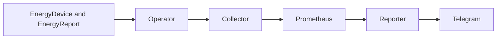

# KubeWattch

### Kubernetes-native energy monitoring

Go · Kubebuilder · Prometheus

[Overview](#-overview) · [Quick Start](#-quick-start) · [Architecture](#-how-it-works) · [Contributing](CONTRIBUTING.md)

## 📋 Table of Contents

- [Overview](#-overview)
- [Why KubeWattch?](#-why-kubewattch)
- [Features and roadmap](#-features-and-roadmap)
- [Quick Start](#-quick-start)
- [Custom Resources](#-custom-resources)
- [Configuration](#️-configuration)
- [How It Works](#-how-it-works)
- [Local Development](#-local-development)
- [Contributing](CONTRIBUTING.md)
- [Security](#-security)
- [License](#-license)

## 📖 Overview

KubeWattch is an early-stage Kubernetes operator for monitoring smart-device energy consumption and reporting its cost. The operator can provision a Tapo collector; live hardware validation is still pending.

## 🤔 Why KubeWattch?

The project aims to bring device configuration, Prometheus monitoring and scheduled consumption reports into a Kubernetes-native workflow. Tapo collection and Telegram reporting are implemented; additional providers and destinations are future work.

## ✨ Features and roadmap

- Namespaced EnergyDevice and EnergyReport APIs with generated CRDs.
- Operator manager and Tapo collector reconciliation.
- Tapo polling and authenticated Prometheus energy metrics; hardware validation is pending.
- Scheduled Prometheus-backed Telegram reports; additional providers and destinations are planned.

## 🚀 Quick Start

Install Go and run `make generate manifests` and `go build -o bin/manager ./cmd`. These commands do not connect to a cluster. The [getting started guide](docs/getting-started.md) describes installation and collector configuration.

## 📡 Custom Resources

The API group is `energy.kubewattch.alvarorg14.github.io/v1alpha1`. See [CRDs](docs/crds.md) and [architecture](docs/architecture.md).

## ⚙️ Configuration

The chart configures the manager image, resources, leader election and optional authenticated Prometheus ServiceMonitor. See the [chart guide](charts/kubewattch/README.md). The device collector requires namespace-local credentials and a serving certificate.

## 🔧 How It Works

## 💻 Local Development

See [development](docs/development.md). Contributions follow Conventional Commits; see [CONTRIBUTING.md](CONTRIBUTING.md).

## 🔒 Security

Report vulnerabilities privately as described in [SECURITY.md](SECURITY.md).

## 📄 License

[Apache 2.0](LICENSE).
