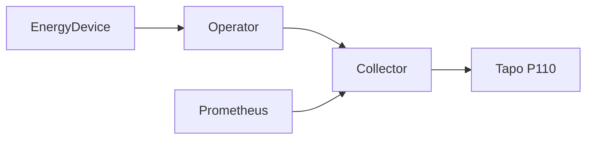

# Architecture

KubeWattch models smart energy devices and scheduled reports as Kubernetes resources. The intended system separates Kubernetes lifecycle management, device communication and report delivery so that providers and destinations can evolve independently.

## Current implementation

The manager watches namespaced devices and reports across the cluster. Each configured EnergyDevice receives a single collector Deployment, Service and restricted ServiceAccount. The collector reads a Tapo device and exposes authenticated HTTPS metrics. The report controller remains a no-op; scheduling and delivery are not implemented. Hardware validation of the collector remains pending.

The manager creates namespace-local collector resources and an authentication binding for each collector. It cleans up the cluster-scoped binding when a device is deleted. Collector serving certificates and credentials are supplied in Secrets in the device namespace.

## Boundaries and safety

`EnergyDevice` and `EnergyReport` are namespaced. Reports select devices in their own namespace, and Secret references point to Secrets in that namespace. The scaffold's types express these boundaries; future reconciliation must enforce them. The manager watches all namespaces, so installation requires cluster-level RBAC.

Controller metrics and device energy metrics use separate authenticated HTTPS endpoints. Helm can render a ServiceMonitor with certificate verification, a trusted CA and an explicit Prometheus ServiceAccount binding. See the [chart guide](../charts/kubewattch/README.md).

## Compatibility and evolution

The `v1alpha1` API is an early contract and can change as integrations are designed. Its version is independent of the operator and Helm release version. CRD upgrades need explicit coordination because Helm does not upgrade CRDs in its `crds/` directory. See [CRDs](crds.md) and [releases](releases.md).
