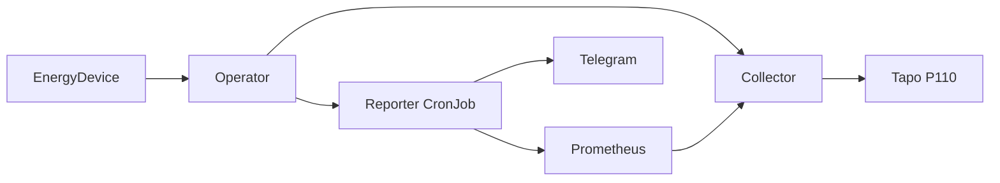

# Architecture

KubeWattch models smart energy devices and scheduled reports as Kubernetes resources. The intended system separates Kubernetes lifecycle management, device communication and report delivery so that providers and destinations can evolve independently.

## Current implementation

The manager watches namespaced devices and reports across the cluster. Each configured EnergyDevice receives a single collector Deployment, Service and restricted ServiceAccount. The collector reads a Tapo device and exposes authenticated HTTPS metrics. The report controller provisions a CronJob and a restricted reporter identity. The reporter queries Prometheus and delivers Telegram messages. Hardware validation of the collector remains pending.

The manager creates namespace-local collector resources and an authentication binding for each collector. It cleans up the cluster-scoped binding when a device is deleted. Collector serving certificates and credentials are supplied in Secrets in the device namespace.

## Boundaries and safety

`EnergyDevice` and `EnergyReport` are namespaced. Reports select devices in their own namespace, and Secret references point to Secrets in that namespace. The reporter enforces these boundaries during device selection and credential mounting. The manager watches all namespaces, so installation requires cluster-level RBAC. It must create and update Services in device namespaces to expose collectors. This cluster-wide permission could redirect Service traffic if the manager were compromised; install the operator as a trusted cluster component. The manager does not have Service delete or patch permissions.

Controller metrics and device energy metrics use separate authenticated HTTPS endpoints. Helm can render a ServiceMonitor with certificate verification, a trusted CA and an explicit Prometheus ServiceAccount binding. See the [chart guide](../charts/kubewattch/README.md).

## Compatibility and evolution

The `v1alpha1` API is an early contract and can change as integrations are designed. Its version is independent of the operator and Helm release version. CRD upgrades need explicit coordination because Helm does not upgrade CRDs in its `crds/` directory. See [CRDs](crds.md) and [releases](releases.md).

## Report execution

Each report owns a CronJob, ServiceAccount, Role, RoleBinding, Lease and ConfigMap. The reporter reads the Job's scheduled timestamp (Kubernetes 1.32 or newer), selects devices in its namespace and queries Prometheus. A per-report Lease serializes execution; a snapshot and status checkpoints retain confirmed messages across retries. Only the mounted Secrets are available to the reporter; its identity has no Secret API permissions.

Telegram cannot guarantee exactly-once delivery. If a send succeeds but its response or checkpoint is lost, a retry may deliver a duplicate. Kubernetes CronJobs can skip schedules, and only the latest execution snapshot is retained.
