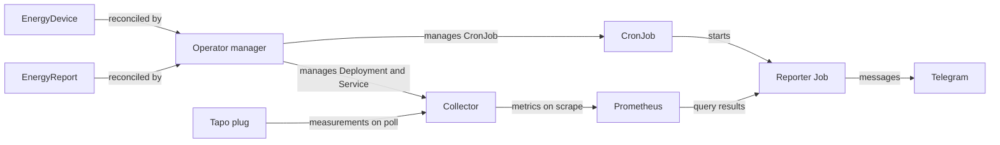

# Architecture

KubeWattch separates Kubernetes reconciliation, device polling, and report execution. One manager watches namespaced `EnergyDevice` and `EnergyReport` resources across the cluster. The chart enables manager leader election by default.

## Workloads and permissions

- Each device owns a single-replica collector Deployment, Service, ServiceAccount, Role, and RoleBinding in its namespace, plus an optional ServiceMonitor. The manager removes the collector's cluster-scoped authentication binding through a device finalizer. The collector uses Kubernetes authentication and authorization for HTTPS metrics and updates its own device status.
- Each report owns a CronJob, ServiceAccount, Role, RoleBinding, Lease, and ConfigMap in its namespace. The reporter reads the report and its Job, lists devices in the same namespace, and writes report status and execution checkpoints.
- Kubernetes mounts the referenced Secret keys into workloads. The workload identities have no Secret API access. Grant write access to the custom resources only to trusted users who may choose which namespace-local Secrets to mount and where workloads connect. The rendered report snapshot is stored in a ConfigMap, so namespace permissions should reflect the sensitivity of device usage data.
- The manager is a trusted cluster component with cluster-wide reconciliation permissions, including permission to create and update Services. Manager and collector metrics are separate authenticated HTTPS endpoints. [Helm chart reference](../charts/kubewattch/README.md)

## Report windows and calculations

The reporter uses the Job's scheduled timestamp, even when the Job starts late. It covers the previous complete local day, Monday–Sunday week, or calendar month in `spec.timeZone`. Local window boundaries account for daylight-saving transitions.

It queries Prometheus on a one-minute grid and integrates fresh, successful power samples over covered time to estimate kWh. Missing samples reduce coverage. Usage totals reflect observed energy and are marked partial when coverage is incomplete. Aggregate average and sampled peak use timestamps with observations from every selected device. The configured fixed tariff determines estimated cost.

The report also shows month-to-date consumption and the latest sampled load. Month and annual projections use the current month's average observed load once at least one hour has elapsed and each selected device has at least 95% month-to-date coverage.

## Scheduling and delivery

The CronJob forbids overlapping runs and has a one-hour starting deadline. Each Job has a 30-minute active deadline and a retry limit of three. Kubernetes can miss schedules. The reporter requires a Job owned by the report CronJob and carrying the scheduled timestamp annotation added by Kubernetes 1.32 and newer. [Kubernetes CronJobs](https://kubernetes.io/docs/concepts/workloads/controllers/cron-jobs/)

The reporter uses a per-report Lease to serialize execution. It stores the latest rendered snapshot in a ConfigMap and records confirmed Telegram message chunks in status so a retry can resume delivery. Telegram can receive a duplicate if it accepted a chunk and the response or checkpoint was lost. A report with partial or unavailable measurements can still be delivered. [Report status](crds.md#status)
