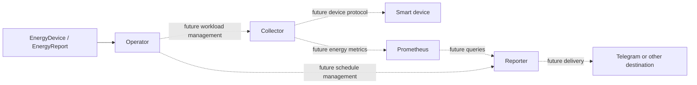

# Architecture

KubeWattch models smart energy devices and scheduled reports as Kubernetes resources. The intended system separates Kubernetes lifecycle management, device communication and report delivery so that providers and destinations can evolve independently.

## Current implementation

The controller-runtime manager registers the `energy.kubewattch.alvarorg14.github.io/v1alpha1` scheme, starts an `EnergyDevice` and an `EnergyReport` controller, exposes health probes and serves authenticated HTTPS controller metrics. It watches both namespaced resources across the cluster. Each reconciler currently returns without changing anything; no workers, schedules or status updates are created.

The manager requires read/watch access to these CRDs, leader-election Lease access when enabled, and TokenReview/SubjectAccessReview permissions for secured metrics. It does not currently need device Secret access or permission to create workloads. Both CRDs expose status subresources for future use.

## Intended data flow

A future collector will handle provider authentication and polling and expose standardized power and energy metrics. A future reporter will query a metrics source, calculate consumption and costs for a calendar period, and deliver the result. The operator is expected to manage their Kubernetes workloads and report health through resource status. Exact workload and interface designs remain open until those features are built.

## Boundaries and safety

`EnergyDevice` and `EnergyReport` are namespaced. Reports select devices in their own namespace, and Secret references point to Secrets in that namespace. The scaffold's types express these boundaries; future reconciliation must enforce them. The manager watches all namespaces, so installation requires cluster-level RBAC.

Controller metrics are distinct from the planned device energy metrics. The former are available over authenticated HTTPS; the latter do not exist yet. Helm can render a ServiceMonitor with certificate verification, a trusted CA and an explicit Prometheus ServiceAccount binding. See the [chart guide](../charts/kubewattch/README.md).

## Compatibility and evolution

The `v1alpha1` API is an early contract and can change as integrations are designed. Its version is independent of the operator and Helm release version. CRD upgrades need explicit coordination because Helm does not upgrade CRDs in its `crds/` directory. See [CRDs](crds.md) and [releases](releases.md).
